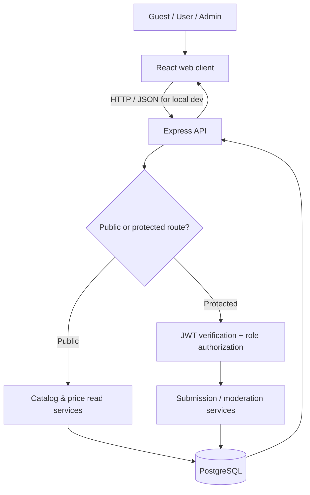
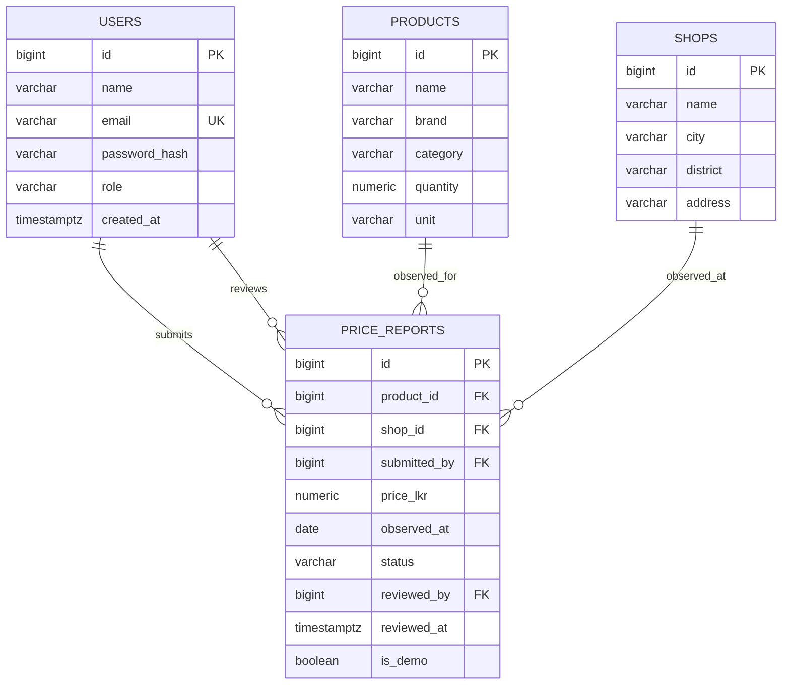
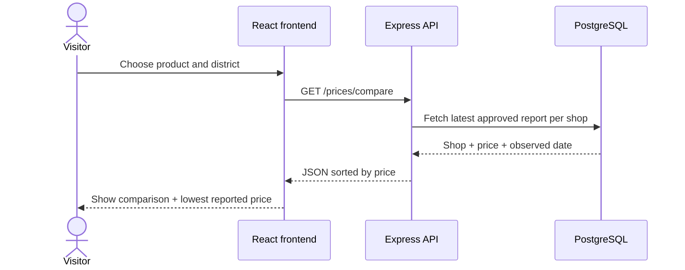
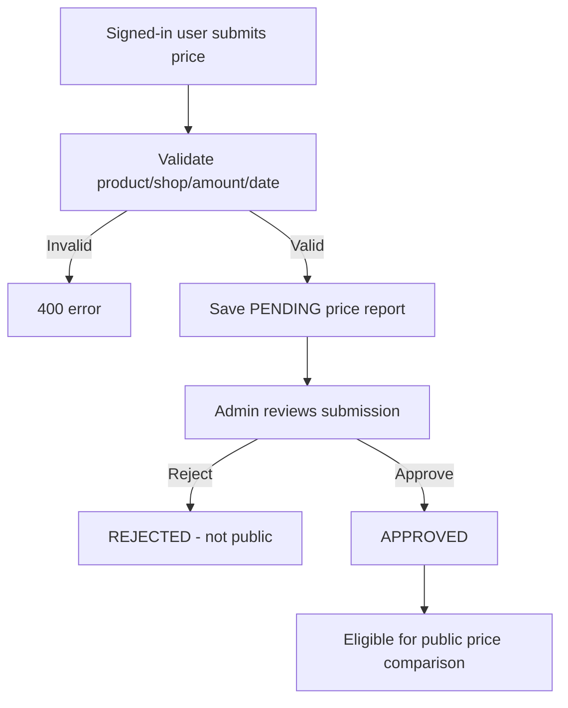

# PricePulse — Project Architecture

**SWYNEX Internship — Task 01**  
**Project title:** PricePulse — Local Grocery Price Comparison System  
**Status:** Architecture defined; educational frontend/backend starter implemented  
**Scope:** Sri Lanka; grocery prices reported by users (not retailer live feeds)

## 1. Problem statement

Grocery shoppers may face different prices for identical products at different shops. Checking individual stores takes time and can make budgeting difficult. PricePulse proposes a transparent, location-aware tool where people can compare reported prices and contribute observations that pass an admin review step.

## 2. Objectives

1. Develop a responsive website to search groceries and compare shops.
2. Show the lowest **reported** price, observation date, and district.
3. Support account creation and price submissions.
4. Moderate new submissions before publishing.
5. Store normalized product, shop, user, and price report records.
6. Demonstrate a maintainable full-stack design with REST endpoints.

**Out of scope for Task 01:** real-time shop inventory, payments, retailer integrations, GPS tracking, OCR, AI forecasting, a mobile app, production deployment, and automatic verification that a user-reported price is correct.

## 3. User roles and access

| Role | Browse products | Compare prices | Submit reports | See own reports | Review reports |
|---|---:|---:|---:|---:|---:|
| Visitor | Yes | Yes | No | No | No |
| Registered User | Yes | Yes | Yes | Yes | No |
| Administrator | Yes | Yes | Yes | Yes | Yes |

## 4. Technology stack

- **Frontend:** React + Vite + modern CSS; Fetch API for asynchronous requests
- **Backend:** Node.js + Express.js; JSON REST API
- **Database:** PostgreSQL with foreign keys, constraints and indexes
- **Authentication:** bcryptjs hashes + JWT, 8-hour token expiry
- **Input validation:** Zod; parameterized `pg` queries; authorization middleware
- **Local dev:** npm scripts, dotenv `.env` files, PostgreSQL CLI or pgAdmin

## 5. High-level architecture



**Frontend responsibilities:** accessible UI, product filters, displays and charts, forms, loading states and errors. It must not enforce security rules on its own.

**Backend responsibilities:** validate input, authenticate users, authorize roles, reject malformed requests, enforce moderation workflow, execute safe SQL, serialize JSON.

**Database responsibilities:** store related entities, enforce primary/foreign keys, unique emails, allowed statuses and positive prices.

## 6. Entity-relationship design



### Table overview

| Table | Fields / reasoning |
|---|---|
| `users` | Unique email, hashed password, USER/ADMIN role |
| `products` | Product name, optional brand, category, numeric quantity and unit for fair comparisons |
| `shops` | Shop name, city, district and address |
| `price_reports` | Price, date observed, submitter, moderation status/reviewer, demo flag; many reports can refer to one shop/product |

**Integrity constraints:** price greater than zero, quantity greater than zero, observation date not in future, allowed statuses, unique emails, relationships by foreign key.

### Important comparison rule

Price comparison is only between reports of the **same product ID**, representing the same product type/size/brand. It is not valid to compare 1 kg to 500 g without normalization. The starter uses per-product identity rather than automatic unit conversion.

## 7. API specifications (summary)

Base URL: `http://localhost:4000/api`. Full examples in [API.md](API.md).

| Method | Endpoint | Access | Description |
|---|---|---|---|
| GET | `/health` | Public | Server health |
| POST | `/auth/register` | Public | Create USER account |
| POST | `/auth/login` | Public | Get bearer token |
| GET | `/auth/me` | User | Get current account |
| GET | `/products` | Public | Product search/category filter |
| GET | `/shops` | Public | Shops/district filter |
| GET | `/districts` | Public | List districts |
| GET | `/stats` | Public | Summary counts |
| GET | `/prices/compare` | Public | Latest approved shop prices |
| GET | `/prices/history` | Public | Recent approved records |
| POST | `/price-reports` | User | Submit PENDING report |
| GET | `/my/price-reports` | User | View own reports |
| GET | `/admin/price-reports` | Admin | Fetch reports by status |
| PATCH | `/admin/price-reports/:id` | Admin | Approve or reject pending report |

### Sample request

`GET /api/prices/compare?productId=1&district=Batticaloa`

Sample response shape (fictional values):

```json
{
  "product": {"id": 1, "name": "White Rice", "quantity": "1.00", "unit": "kg"},
  "district": "Batticaloa",
  "items": [
    {"shop_id": 1, "shop_name": "Market One", "city": "Batticaloa", "district": "Batticaloa", "price_lkr": "228.00", "observed_at": "2026-10-30", "is_demo": true}
  ]
}
```

## 8. Main user workflow



## 9. Price submission and approval



Only an `ADMIN` role can change `PENDING` to `APPROVED` or `REJECTED`. The starter does not let moderators edit an approved price in place; a new report is submitted instead so observations can be retained.

## 10. Frontend page plan

| Screen | Key content |
|---|---|
| Home / Discover | Welcome, sample catalogue, search/category filters, summary statistics |
| Compare Prices | Product & district selectors, price ranking, lowest reported and price spread |
| Login/Register modal | Account creation and sign-in forms |
| Submit Price | Product, shop, LKR amount, observation date |
| My Reports | Submissions and pending/approved/rejected status |
| Admin Dashboard | Pending prices and approve/reject controls |

**Responsive approach:** flexible grid, 2-column tablet, single-column mobile layout, accessible labels and visible UI feedback.

## 11. Security decisions

- Passwords stored only as bcrypt hashes, not plaintext.
- JWT needed for protected routes; server verifies the signature and checks the role.
- Only server-side authorization can grant admin access.
- Queries use parameter placeholders; no SQL string concatenation of user values.
- Data validation enforces types, price ranges, positive IDs, valid dates and product/shop existence.
- Helmet sets common security response headers.
- CORS restricts the allowed frontend origin in local development.
- Authentication route requests are rate-limited.
- Secrets belong in `.env`, never GitHub. `.env.example` contains placeholders only.

**For production:** use TLS, secure token handling (e.g. HttpOnly cookies with CSRF protection), stricter rate limiting, audit logs, account recovery and email verification, robust monitoring, multi-instance deployment configuration and integration tests. The browser starter uses sessionStorage for the short-lived demo JWT, which is not a comprehensive production session strategy.

## 12. Accuracy, trust, privacy

- Only **approved** reports appear in public comparison endpoints.
- Every shown shop price includes the date it was observed.
- Seeded shop names/prices are **fictional demos** and marked `is_demo=true`.
- Admin approval is a moderation step, not proof that a store currently offers that price.
- Public endpoints do not expose a reporter's email, password hash, or personal identity.
- Do not describe PricePulse as a live price verification service.

## 13. Testing strategy

| Test | Expected outcome |
|---|---|
| Register account | Valid new email creates USER account |
| Duplicate email | 409 response |
| Login invalid password | 401 response |
| Search products | Filtered product list |
| Compare prices | Latest approved price per matching shop, ascending order |
| Submit negative price | 400 validation error |
| Submit without token | 401 response |
| Non-admin review attempt | 403 response |
| Approve a PENDING report | Status becomes APPROVED |
| Review already resolved report | 404 response; no second review |
| Device responsiveness | Main content remains usable on mobile widths |

Backend includes `node --test` unit checks for request parsing. Database integration and UI end-to-end tests are future work.

## 14. Risks and mitigation

| Risk | Mitigation |
|---|---|
| Incorrect user reports | Admin review, observation timestamps, future receipt/evidence workflow |
| Stale prices | Show date; future automated freshness warning |
| Different pack sizes | Compare same product ID/size, not merely product name |
| Unauthorized moderation | JWT verification + server-side admin role check |
| Weak demo coverage | Separate illustrative seed data from claims about actual shops |
| Expansion and performance | Index approved price reports, paginate future APIs |

## 15. Future enhancements

- Receipts or photo evidence for report review
- Admin notes and rejection reasons
- Price trend chart and 30-day history
- Favorite products, alerts and shopping list estimates
- User trust scores and spam protection
- Geocoded shop locations
- Verified retailer or authority data feeds
- Deployment with HTTPS, monitoring and backups

## 16. Expected Task 01 deliverable

A GitHub repository with this architecture document, relational schema, implemented core API skeleton, React UI starter, sample data, local setup instructions and a LinkedIn explanation/demo. Full commercial launch is **not** part of Task 01.
